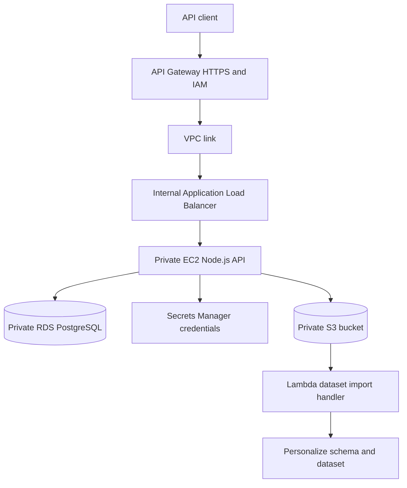

# FitAI Tracker | AWS Infrastructure Portfolio Project

FitAI Tracker is a workout logging API deployed in AWS with Terraform. It stores synthetic workout records in PostgreSQL and exposes an HTTPS endpoint. The project demonstrates private networking, managed database credentials, infrastructure as code, and IAM protected API routes.

**Project status:** The deployed `/health` endpoint and the workout database flow were tested. AWS Personalize infrastructure and a dataset import pipeline are provisioned; recommendation generation has not been verified. This project should not be described as a working recommendation engine yet.

## Architecture



- **Region:** `us-east-2`.
- **Networking:** The VPC has two public and two private subnets. The API server, database, internal load balancer, and API Gateway VPC link use private subnets. The NAT gateway allows outbound access from private subnets for application setup and AWS service calls.
- **Entry point:** API Gateway supplies the default `execute-api` HTTPS URL. A VPC link connects it to the internal Application Load Balancer, which forwards requests to the Node.js server on EC2.
- **Database and credentials:** Amazon RDS for PostgreSQL holds workout records. The app retrieves the RDS managed secret from Secrets Manager; the database is not publicly accessible.
- **Storage and import:** An S3 bucket stores project data. An S3 event invokes Lambda for the Personalize dataset import workflow. Terraform provisions a Personalize schema, dataset group, and interactions dataset. A trained model and recommendation endpoint are outside the verified scope.
- **Operations:** Systems Manager provides instance access without inbound SSH. API Gateway access logs go to CloudWatch Logs. Terraform manages the log group and its retention.

The former internet-facing ALB was removed after the internal route worked. The public HTTP endpoint is no longer part of the deployed architecture.

## Workout API

| Method | Path | Access | Purpose |
| --- | --- | --- | --- |
| `GET` | `/health` | Public | Confirms the Node.js service is responding. |
| `POST` | `/workouts` | AWS IAM signed request | Saves a synthetic workout. |
| `GET` | `/workouts` | AWS IAM signed request | Returns stored workouts. |

Workout fields include `exercise`, `sets`, `reps`, `weight_kg`, and `workout_date`. A synthetic example:

```json
{
  "exercise": "Portfolio Test Squat",
  "sets": 3,
  "reps": 8,
  "weight_kg": 80,
  "workout_date": "2026-09-23"
}
```

The database also records an ID and creation time. Route-level `AWS_IAM` authorization requires SigV4 signed requests and permission to invoke the protected routes. This is AWS credential based access for the portfolio demonstration; it is not an end-user sign-in system.

## Deploy with Terraform

Prerequisites: Terraform, the AWS CLI with an AWS identity authorized to provision these services, a public Node.js API repository, and a local `terraform.tfvars` configured for the intended AWS account and region. Do not commit `terraform.tfvars`, local state, secrets, or credentials to Git.

1. Clone or open the infrastructure repository in VS Code.
2. Set the project inputs in `terraform.tfvars`, including `aws_region = "us-east-2"` and `app_repository_url = "https://github.com/dushawnbutler/fitai-api.git"`.
3. Initialize and review the configuration:

   ```bash
   terraform init
   terraform fmt
   terraform validate
   terraform plan
   ```

4. Review resource creations and any replacements, then deploy:

   ```bash
   terraform apply
   ```

5. Follow the app's migration procedure to create the `workouts` table in RDS. The API repository contains the schema and migration script; database setup is a separate application step.
6. Obtain the HTTPS endpoint and verify the deployed service:

   ```bash
   HTTPS_API="$(terraform output -raw https_api_url)"
   curl -i "$HTTPS_API/health"
   curl -i "$HTTPS_API/workouts"
   ```

   The health request should return HTTP 200 and `{"status":"ok","service":"fitai-api"}`. The unsigned workout request should return HTTP 403. A correctly signed request with `execute-api:Invoke` permission should return stored workout data.

### Verification screenshots

Save screenshots in `docs/screenshots/` and replace the placeholders below. Capture the terminal command and HTTP result, but crop out unrelated terminal history and account details.

**HTTPS health check — insert screenshot here:** `docs/screenshots/https-health.png`


Take the Terraform screenshot only after applying and running `terraform plan` again; it should show **No changes**. The health screenshot should show the HTTPS API Gateway URL and HTTP 200 response.

## Problems solved

| Problem | Resolution | What it demonstrates |
| --- | --- | --- |
| Terraform reported a cycle between the app and ALB security groups. | Defined security group ingress and egress rules as separate Terraform resources, allowing the references to be resolved without a resource cycle. | Terraform dependency management and least privilege network rules. |
| API Gateway returned 503 while the original public ALB health check returned 200. | Checked VPC link status, target health, access logs, and security group rules. Added an internal ALB in the private subnets and pointed the VPC link integration at its listener. Verified `/health` over HTTPS, then removed the unused public ALB. | Isolating failures across API Gateway, VPC networking, and load balancing. |
| The public API needed controlled access to workout data. | Kept `/health` open for monitoring and configured `GET` and `POST /workouts` with `AWS_IAM`. Verified unsigned requests return 403 and signed requests can access workout data. | SigV4 authorization and scoped API access. |
| Logging was enabled in the AWS console during troubleshooting. | Imported the existing CloudWatch log group into Terraform and defined the stage access log settings in code. | Bringing a manual diagnostic change back under infrastructure as code. |

## Scope and next improvements

- **Personalize:** The schema, dataset group, dataset, and import pipeline are infrastructure for a possible recommendation feature. Do not claim that a model is trained or that the app returns AI recommendations until an import, training workflow, deployment, and recommendation request have been tested.
- **Users:** IAM protected routes are suitable for this AWS portfolio test. A consumer fitness app would need user accounts and per-user authorization before storing real workout data.
- **Data:** Use synthetic workouts for demonstrations. Review backup, retention, and privacy requirements before handling real fitness information.
- **Cost:** EC2, RDS, NAT gateway, internal ALB, API Gateway, and other provisioned services may incur ongoing charges while deployed. Review the running stack when the demonstration is over.
